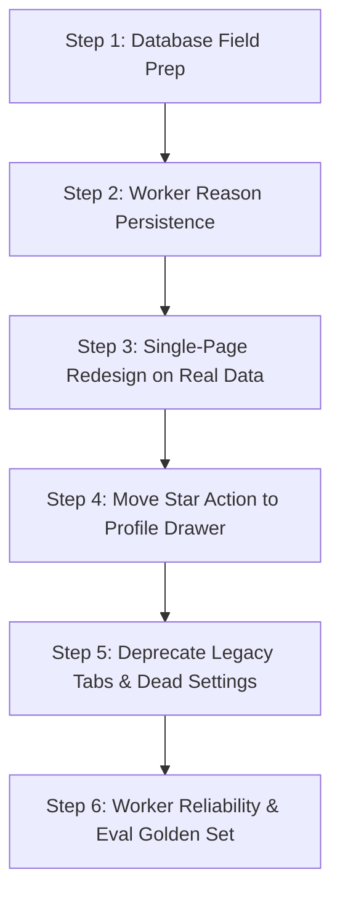

# Functional and Behavioral Audit of FollowMe

**Audit Date**: October 2026  
**Audited Branch**: `dashboard-refactor`  
**Scope**: Read-only codebase audit across `/worker`, `/dashboard`, `/demo`, and PostgreSQL database schemas (`schema.sql`).  
**Status**: Read-only complete. Live Supabase database queries marked `PENDING` with exact copy-paste SQL provided for verification.

---

## 1. SCORING PIPELINE

### a. Model name / Endpoint, Temperature, Max Tokens, Other Params
* **Primary AI Client**: Groq OpenAI-compatible client (`https://api.groq.com/openai/v1`) with fallback to NVIDIA NIM (`https://integrate.api.nvidia.com/v1`).
  * *Evidence*: [`worker/src/nvidia.ts:14-26`](file:///c:/Users/Admin/Desktop/madhan/followme/worker/src/nvidia.ts#L14-L26)
* **Model Discovery & Fallback List**:
  * Groq preferred list (dynamic discovery via `client.models.list()` falling back to candidates):  
    `llama-3.3-70b-versatile`, `llama-3.1-8b-instant`, `qwen-2.5-coder-32b`, `deepseek-r1-distill-llama-70b`.  
    *Evidence*: [`worker/src/nvidia.ts:198-203`](file:///c:/Users/Admin/Desktop/madhan/followme/worker/src/nvidia.ts#L198-L203)
  * NVIDIA NIM preferred list:  
    `meta/llama-3.1-70b-instruct`, `nvidia/llama-3.1-nemotron-70b-instruct`, `mistralai/mistral-7b-instruct-v0.3`, `meta/llama-3.3-70b-instruct`, `meta/llama-3.1-8b-instruct`, `google/gemma-2-9b-it`.  
    *Evidence*: [`worker/src/nvidia.ts:226-233`](file:///c:/Users/Admin/Desktop/madhan/followme/worker/src/nvidia.ts#L226-L233)
* **Sampling Parameters**:
  * `temperature: 0.1`  
  * `max_tokens: 250`  
  * `messages`: Single message role `'user'` containing prompt (system prompt is concatenated into the user prompt string).  
  * *Evidence*: [`worker/src/nvidia.ts:78-88`](file:///c:/Users/Admin/Desktop/madhan/followme/worker/src/nvidia.ts#L78-L88)

### b. Full Prompt Text Sent to LLM (Verbatim)
* *Evidence*: [`worker/src/nvidia.ts:164-192`](file:///c:/Users/Admin/Desktop/madhan/followme/worker/src/nvidia.ts#L164-L192)

```text
You are an expert software developer and peer community evaluator.
${customSystemPrompt ? `System Focus Guidance: ${customSystemPrompt}\n` : ''}
Evaluate the following GitHub repository and grade it on a scale of 1 to 10 based on:
1. **Learning Effort**: Does this show active learning, dedication, and practical coding practice? (e.g., student assignments, personal experiments, build-in-public projects).
2. **Originality**: Is it a genuine personal attempt, interesting hackathon project, or custom tool? Avoid penalizing it for being simple, but do penalize if it is an unchanged 1-to-1 clone/fork.
3. **Usefulness & Clarity**: Is the README helpful? Does it demonstrate a working prototype?

We want to discover and support active builders, students, and peers who are coding and experimenting, rather than exclusively massive corporate libraries or senior celebrity projects. Give higher scores (7+) to active, original peer builders.

Repository Details:
- Name: ${repo.owner}/${repo.name}
- URL: ${repo.github_url}
- Description: ${repo.description}
- Language: ${repo.language}
- Stars: ${repo.stars}
- Topics: ${repo.topics.join(', ')}

README Snippet:
"""
${snippet}
"""

Return your evaluation EXACTLY in the following JSON format. Do not add any conversational text or markdown code fence wrappers (like ```json). Just the raw JSON object.
{
  "grade": <integer between 1 and 10>,
  "reason": "<short 1-2 sentence explanation of the grade>"
}
```

* **Expected Output Schema**:
```json
{
  "grade": <integer between 1 and 10>,
  "reason": "<short 1-2 sentence explanation of the grade>"
}
```

### c. Score Scale, Sub-scores, and Reason
* **Prompt Scale**: 1 to 10 (`"grade": <integer between 1 and 10>`). Prompt asks to *"Give higher scores (7+) to active, original peer builders."* ([`worker/src/nvidia.ts:172, 189`](file:///c:/Users/Admin/Desktop/madhan/followme/worker/src/nvidia.ts#L172-L189)).
* **Sub-scores**: **DO NOT EXIST** in worker prompt or worker output. There are no sub-scores for `activity`, `codeQuality`, `relevance`, or `reach` in the worker pipeline.
* **Reason Produced**: **YES**. 1-2 sentence explanation returned by LLM as `result.reason`. Defaults to `"Graded by ${providerName}"` if blank ([`worker/src/nvidia.ts:112`](file:///c:/Users/Admin/Desktop/madhan/followme/worker/src/nvidia.ts#L112)).

### d. Raw Output Handling in Worker
* **Cleaning / Regex**:
  * Strips deep-thinking tags: `cleanedContent = content.replace(/<think>[\s\S]*?<\/think>/gi, '').trim()` ([`worker/src/nvidia.ts:96`](file:///c:/Users/Admin/Desktop/madhan/followme/worker/src/nvidia.ts#L96)).
  * Extracts outermost JSON braces: `cleanedContent.match(/\{[\s\S]*\}/)` or strips markdown code fences `` ````(json)? `` ([`worker/src/nvidia.ts:98-103`](file:///c:/Users/Admin/Desktop/madhan/followme/worker/src/nvidia.ts#L98-L103)).
* **Parsing & Clamping**:
  * Parsed via `JSON.parse(cleanedContent)`.
  * Rounded via `let grade = Math.round(Number(result.grade))`.
  * Fallback if NaN: `if (isNaN(grade)) grade = 1`.
  * Hard clamped: `grade = Math.max(1, Math.min(10, grade))` ([`worker/src/nvidia.ts:106-109`](file:///c:/Users/Admin/Desktop/madhan/followme/worker/src/nvidia.ts#L106-L109)).
* **Multiplication / Normalization**: **NONE**. The score remains strictly an integer between 1 and 10.
* **Fallback & Retry**:
  * If Groq primary model fails, iterates across `preferredGroq` list ([`worker/src/nvidia.ts:213-221`](file:///c:/Users/Admin/Desktop/madhan/followme/worker/src/nvidia.ts#L213-L221)).
  * If Groq exhausts all attempts, fails over to NVIDIA NIM and iterates `preferredNvidia` list ([`worker/src/nvidia.ts:225-250`](file:///c:/Users/Admin/Desktop/madhan/followme/worker/src/nvidia.ts#L225-L250)).
  * If all fail, throws `FatalAiQuotaError` ([`worker/src/nvidia.ts:254`](file:///c:/Users/Admin/Desktop/madhan/followme/worker/src/nvidia.ts#L254)), causing the worker to halt AI evaluation for that run, log to DB/email, and proceed to non-AI cleanups ([`worker/src/index.ts:268-278`](file:///c:/Users/Admin/Desktop/madhan/followme/worker/src/index.ts#L268-L278)).

### e. Input Data Fed to LLM
Only repository-level data and owner login string are passed to the LLM ([`worker/src/nvidia.ts:175-185`](file:///c:/Users/Admin/Desktop/madhan/followme/worker/src/nvidia.ts#L175-L185), [`worker/src/github.ts:269-288`](file:///c:/Users/Admin/Desktop/madhan/followme/worker/src/github.ts#L269-L288)):
1. `repo.owner` & `repo.name`
2. `repo.github_url`
3. `repo.description` (from GitHub repository search result)
4. `repo.language`
5. `repo.stars` (stargazers count)
6. `repo.topics` (array of repository topics)
7. `repo.readme_snippet` (first 3000 chars fetched from GitHub API `/repos/{owner}/{name}/readme`, truncated to first 2000 chars before LLM injection)
* **What is NOT passed**: User profile bio, user follower/following count, commit count, account age, and other repos of the user are **NOT** fed into the LLM prompt. (The owner's profile stats are only used separately for deterministic filtering before grading).

### f. Thresholds Depending on Score
* **Follow & Star threshold**: `grading.grade >= config.gradeThreshold` (default = **7** on 1-10 scale).  
  * Evidence: [`worker/src/index.ts:292`](file:///c:/Users/Admin/Desktop/madhan/followme/worker/src/index.ts#L292), [`worker/src/supabase.ts:195`](file:///c:/Users/Admin/Desktop/madhan/followme/worker/src/supabase.ts#L195), `worker/.env.example:6`.
* **Skip threshold**: Any profile below `config.gradeThreshold` (< 7) is skipped from following/starring, stored in DB with `follow_skipped: true` and `grade: grading.grade` ([`worker/src/index.ts:352-369`](file:///c:/Users/Admin/Desktop/madhan/followme/worker/src/index.ts#L352-L369)).
* **Pre-filter skip**: Profiles filtered out prior to LLM evaluation are stored with `grade: 0` and `follow_skipped: true` ([`worker/src/index.ts:199, 221, 248`](file:///c:/Users/Admin/Desktop/madhan/followme/worker/src/index.ts#L199-L248)).
* **Organic/Inbound follower dummy grade**: Unseen organic followers added during `syncMutuals` receive arbitrary `grade: 5` ([`worker/src/index.ts:973`](file:///c:/Users/Admin/Desktop/madhan/followme/worker/src/index.ts#L973)).
* **Dashboard / UI Thresholds**:
  * Top quality score styling: `profile.avgGrade >= 9.0` (emerald) vs `>= 7.0` (red) vs lower (orange) ([`dashboard/src/components/ProfileCard.tsx:187-189`](file:///c:/Users/Admin/Desktop/madhan/followme/dashboard/src/components/ProfileCard.tsx#L187-L189), [`dashboard/src/components/ReposGrid.tsx:21-23`](file:///c:/Users/Admin/Desktop/madhan/followme/dashboard/src/components/ReposGrid.tsx#L21-L23)).
  * Displayed format: `(repo.grade ?? 0).toFixed(1)/10` ([`dashboard/src/components/ReposGrid.tsx:123`](file:///c:/Users/Admin/Desktop/madhan/followme/dashboard/src/components/ReposGrid.tsx#L123)).
* **Demo App Thresholds**:
  * Scale assumed: **0-100** ([`demo/public/index.html:462, 598`](file:///c:/Users/Admin/Desktop/madhan/followme/demo/public/index.html#L462-L598)).
  * Follow queue threshold: `>= 60` ([`demo/public/index.html:463, 691`](file:///c:/Users/Admin/Desktop/madhan/followme/demo/public/index.html#L463-L691)).
  * Top pick threshold: `>= 90` ([`demo/public/index.html:472, 599, 691`](file:///c:/Users/Admin/Desktop/madhan/followme/demo/public/index.html#L472-L691)).
  * Skip threshold: `< 60` ([`demo/public/index.html:463, 526, 691`](file:///c:/Users/Admin/Desktop/madhan/followme/demo/public/index.html#L463-L691)).

### g. DB Column & Histogram
* **Column Name & Type**: `grade INTEGER` on table `repos` ([`schema.sql:11`](file:///c:/Users/Admin/Desktop/madhan/followme/schema.sql#L11)).
* **Database State**: `PENDING` (Live Supabase access requires external connection).
* **Exact SQL to run**:
```sql
SELECT 
    min(grade) AS min_grade, 
    max(grade) AS max_grade, 
    avg(grade)::numeric(10,2) AS avg_grade, 
    count(*) AS total_rows,
    count(CASE WHEN grade IS NULL THEN 1 END) AS null_grades
FROM repos;

SELECT 
    COALESCE(grade, -1) AS grade_bucket, 
    count(*) AS count,
    round(100.0 * count(*) / sum(count(*)) over (), 2) AS pct
FROM repos 
GROUP BY grade 
ORDER BY grade_bucket ASC;
```

### h. Calibration, Few-Shot, Golden Set, Eval Script
* **Calibration / Few-shot**: **NO**. Prompt has zero few-shot examples.
* **Golden Set**: **NO**.
* **Eval Script / Logged Accuracy**: **NO**. No evaluation script or accuracy logger exists in the codebase.

### i. VERDICT: Scale Mismatch
* **Worker & DB Reality**: Strict **1 to 10** integer scale (`grade INTEGER`). Pre-filter skips are given `0`. Inbound followers given `5`.
* **Dashboard Current Reality**: Displays **1-10** (`X.X/10`).
* **Demo App Reality**: Assumes **0 to 100** scale (`35..97`), with 4 fictional sub-scores (`activity`, `codeQuality`, `relevance`, `reach`), interactive sliders, and `>= 90` top-picks.
* **Redesign Mismatch**: Any redesign adopting the 0-100 score, sub-score bars, or score-based bands without database and worker changes will display completely broken data (or flat 0-10 numbers rendered in a 100-pt meter).

---

## 2. DATABASE REALITY

Based on canonical repository schema ([`schema.sql`](file:///c:/Users/Admin/Desktop/madhan/followme/schema.sql)) and active code references:

### Schema Overview

| Table | Columns (Type, Nullability, Default) | Indexes | RLS Policies |
|---|---|---|---|
| `repos` | `id BIGINT PRIMARY KEY`<br>`github_url TEXT NOT NULL`<br>`owner TEXT NOT NULL`<br>`name TEXT NOT NULL`<br>`stars INTEGER NOT NULL DEFAULT 0`<br>`language TEXT NULL`<br>`topics TEXT[] DEFAULT '{}'`<br>`readme_snippet TEXT NULL`<br>`grade INTEGER NULL`<br>`graded_at TIMESTAMPTZ NULL`<br>`followed BOOLEAN DEFAULT FALSE`<br>`starred BOOLEAN DEFAULT FALSE`<br>`followed_at TIMESTAMPTZ NULL`<br>`follow_back BOOLEAN DEFAULT FALSE`<br>`unfollowed BOOLEAN DEFAULT FALSE`<br>`follow_skipped BOOLEAN DEFAULT FALSE`<br>`follow_skip_reason TEXT NULL`<br>`created_at TIMESTAMPTZ DEFAULT NOW()` | `idx_repos_grade` (`grade`)<br>`idx_repos_language` (`language`)<br>`idx_repos_followed` (`followed`)<br>`idx_repos_starred` (`starred`)<br>`idx_repos_follow_back` (`follow_back`)<br>`idx_repos_unfollowed` (`unfollowed`)<br>`idx_repos_follow_skipped` (`follow_skipped`) | RLS Enabled.<br>`Allow select`: `true` (Anon SELECT). Writes via service role key or anon key depending on backend client setup. |
| `logs` | `id BIGINT GENERATED ALWAYS AS IDENTITY PRIMARY KEY`<br>`action TEXT NOT NULL`<br>`repo_id BIGINT REFERENCES repos(id) ON DELETE SET NULL`<br>`timestamp TIMESTAMPTZ DEFAULT NOW()`<br>`status TEXT NOT NULL`<br>`message TEXT NULL` | `idx_logs_timestamp` (`timestamp DESC`) | RLS Enabled.<br>`Allow select`: `true` |
| `run_summary` | `id UUID DEFAULT gen_random_uuid() PRIMARY KEY`<br>`ran_at TIMESTAMPTZ DEFAULT now()`<br>`profiles_followed INT DEFAULT 0`<br>`profiles_unfollowed INT DEFAULT 0`<br>`repos_starred INT DEFAULT 0`<br>`mutuals_found INT DEFAULT 0`<br>`profiles_skipped INT DEFAULT 0`<br>`profiles_evaluated INT DEFAULT 0`<br>`run_type TEXT DEFAULT 'evaluation'` | Primary Key UUID | RLS Enabled.<br>`Allow select`: `true` |
| `incident_log` | `id UUID DEFAULT gen_random_uuid() PRIMARY KEY`<br>`incident_type TEXT UNIQUE NOT NULL`<br>`last_sent_at TIMESTAMPTZ DEFAULT now()`<br>`status TEXT NOT NULL DEFAULT 'ACTIVE'`<br>`metadata JSONB DEFAULT '{}'::jsonb` | `idx_incident_log_type` (`incident_type`) | RLS Enabled.<br>`Allow select incident_log`: `true` |
| `settings` | `id UUID DEFAULT gen_random_uuid() PRIMARY KEY`<br>`key TEXT UNIQUE NOT NULL`<br>`value JSONB NOT NULL`<br>`updated_at TIMESTAMPTZ DEFAULT now()` | Unique on `key` | RLS Enabled.<br>`Allow select non-sensitive settings`: `key NOT IN ('github_token', 'resend_api_key', 'dashboard_password')` |

### Critical Clarification: The Ambiguous `repos` Table
* **What does `repos` hold?**: **BOTH repositories and developer profiles.**
* **Mechanism**:
  1. Primary records originate from `searchRecentRepos` ([`worker/src/github.ts:243`](file:///c:/Users/Admin/Desktop/madhan/followme/worker/src/github.ts#L243)). The `id` is the **GitHub Repository ID**. `owner` is the author's login.
  2. If a developer has multiple candidate repositories evaluated, multiple rows exist with the same `owner` but different `id` and `name`.
  3. Inbound organic followers (who followed the authenticated user without an evaluated repo) are synthesised directly into `repos` with:  
     `id = 1000000000000 + follower.id` (artificial ID), `name = follower.login`, `language = 'Profile'`, `grade = 5`, `followed = false`, `follow_back = true` ([`worker/src/index.ts:966-981`](file:///c:/Users/Admin/Desktop/madhan/followme/worker/src/index.ts#L966-L981), [`dashboard/src/app/api/sync-following/route.ts:153-168`](file:///c:/Users/Admin/Desktop/madhan/followme/dashboard/src/app/api/sync-following/route.ts#L153-L168)).
  4. The dashboard aggregates these repository rows client-side in `useMemo` into a synthetic `ProfileItem` grouping by `owner.toLowerCase()` ([`dashboard/src/app/DashboardView.tsx:420-474`](file:///c:/Users/Admin/Desktop/madhan/followme/dashboard/src/app/DashboardView.tsx#L420-L474)).
* **Are Repositories Scored?**: **YES**. Only repositories are scored by the LLM. The profile's grade in the dashboard is the average or top score among the owner's repos in the `repos` table ([`dashboard/src/app/DashboardView.tsx:449-456`](file:///c:/Users/Admin/Desktop/madhan/followme/dashboard/src/app/DashboardView.tsx#L449-L456)).
* **Are Starred Repos Separate?**: **NO**. Starred repos are simply rows in `repos` with `starred = true`.

### Read/Write Audit for Columns
* **Columns NEVER written by the worker**:
  * None on `repos` (worker writes `id`, `github_url`, `owner`, `name`, `stars`, `language`, `topics`, `readme_snippet`, `grade`, `graded_at`, `followed`, `starred`, `followed_at`, `follow_back`, `unfollowed`, `follow_skipped`, `follow_skip_reason`).
* **Columns NEVER read by the dashboard**:
  * `repos.created_at`: Never read or sorted by in dashboard UI (dashboard sorts by `graded_at` or `grade`).
  * `logs.repo_id`: Joined/selected but never rendered as a clickable link or filtered by in `LogsTable`.
  * `run_summary.mutuals_found` & `run_summary.profiles_skipped`: Stored in DB, but `filteredSummary` in `StatsTab` calculates mutuals from live profile aggregation instead of relying on `run_summary.mutuals_found`.
* **Ghost Table Reference**:
  * Worker code attempts to write to `worker_logs` table before falling back to `logs` ([`worker/src/index.ts:49-65`](file:///c:/Users/Admin/Desktop/madhan/followme/worker/src/index.ts#L49-L65)). `worker_logs` does not exist in `schema.sql`.

### Exact Verification SQL for Supabase Editor
```sql
-- 1. Table definitions, types, nullability
SELECT table_name, column_name, data_type, is_nullable, column_default
FROM information_schema.columns
WHERE table_schema = 'public' AND table_name IN ('repos', 'logs', 'run_summary', 'incident_log', 'settings')
ORDER BY table_name, ordinal_position;

-- 2. Row counts, oldest & newest timestamps
SELECT 'repos' AS tbl, count(*) AS total_rows, min(created_at) AS oldest, max(created_at) AS newest FROM repos
UNION ALL
SELECT 'logs', count(*), min(timestamp), max(timestamp) FROM logs
UNION ALL
SELECT 'run_summary', count(*), min(ran_at), max(ran_at) FROM run_summary
UNION ALL
SELECT 'incident_log', count(*), min(last_sent_at), max(last_sent_at) FROM incident_log
UNION ALL
SELECT 'settings', count(*), min(updated_at), max(updated_at) FROM settings;

-- 3. Discriminator & status distribution in repos table
SELECT 
    CASE WHEN language = 'Profile' THEN 'inbound_profile' ELSE 'scanned_repo' END AS record_type,
    followed, 
    starred, 
    follow_back, 
    unfollowed, 
    follow_skipped, 
    count(*) AS count
FROM repos
GROUP BY 1, 2, 3, 4, 5, 6
ORDER BY count DESC;

-- 4. Sample row from repos
SELECT * FROM repos ORDER BY id DESC LIMIT 1;

-- 5. Nullability check for columns in repos
SELECT 
    count(*) total,
    count(github_url) has_url,
    count(language) has_language,
    count(readme_snippet) has_readme,
    count(grade) has_grade,
    count(followed_at) has_followed_at,
    count(follow_skip_reason) has_skip_reason
FROM repos;
```

---

## 3. WORKER BEHAVIOR INVENTORY

### HTTP Endpoints
All protected endpoints require header `x-worker-secret: <WORKER_SECRET>` or body `{ "secret": "<WORKER_SECRET>" }` ([`worker/src/index.ts:549, 587, 600, 612, 658, 690, 736, 768, 814, 858, 1376`](file:///c:/Users/Admin/Desktop/madhan/followme/worker/src/index.ts#L549-L1376)).

| Endpoint | Method | Auth | Description |
|---|---|---|---|
| `/run` | POST | `WORKER_SECRET` | Asynchronously launches main automation pipeline `runAutomationJob(true)` (bypasses working hours check) ([`worker/src/index.ts:548-563`](file:///c:/Users/Admin/Desktop/madhan/followme/worker/src/index.ts#L548-L563)). Returns 409 if already running. |
| `/health` | GET | None | Returns `{ status: 'ok', jobRunning: boolean }` ([`worker/src/index.ts:566-568`](file:///c:/Users/Admin/Desktop/madhan/followme/worker/src/index.ts#L566-L568)). |
| `/status` | GET | None | Returns live GitHub stats (`following`, `followers`, `ratio`), scheduler timestamps (`lastRun`, `nextRun`), and `consecutiveFailures` ([`worker/src/index.ts:571-582`](file:///c:/Users/Admin/Desktop/madhan/followme/worker/src/index.ts#L571-L582)). |
| `/cleanup` | POST | `WORKER_SECRET` | Asynchronously runs grace-period cleanup `runCleanupJob()` ([`worker/src/index.ts:585-594`](file:///c:/Users/Admin/Desktop/madhan/followme/worker/src/index.ts#L585-L594)). |
| `/sync-mutuals` | POST | `WORKER_SECRET` | Asynchronously triggers mutuals sync and inbound follower discovery `syncMutuals()` ([`worker/src/index.ts:597-606`](file:///c:/Users/Admin/Desktop/madhan/followme/worker/src/index.ts#L597-L606)). |
| `/cleanlogs` | POST | `WORKER_SECRET` | Purges logs older than latest 200 entries in batches of 200 ([`worker/src/index.ts:609-652`](file:///c:/Users/Admin/Desktop/madhan/followme/worker/src/index.ts#L609-L652)). |
| `/clearstale` | POST | `WORKER_SECRET` | Deletes rows where `followed=false`, `starred=false`, `unfollowed=false`, `follow_back=false`, and `follow_skipped=true` ([`worker/src/index.ts:655-684`](file:///c:/Users/Admin/Desktop/madhan/followme/worker/src/index.ts#L655-L684)). |
| `/star` | POST | `WORKER_SECRET` | Stars repository `{ owner, repo }` on GitHub and updates DB ([`worker/src/index.ts:687-730`](file:///c:/Users/Admin/Desktop/madhan/followme/worker/src/index.ts#L687-L730)). |
| `/unstar` | POST | `WORKER_SECRET` | Unstars repository `{ owner, repo }` on GitHub and updates DB ([`worker/src/index.ts:765-808`](file:///c:/Users/Admin/Desktop/madhan/followme/worker/src/index.ts#L765-L808)). |
| `/follow` | POST | `WORKER_SECRET` | Follows user `{ username }` on GitHub and sets `followed=true, unfollowed=false, followed_at=now()` in DB ([`worker/src/index.ts:811-853`](file:///c:/Users/Admin/Desktop/madhan/followme/worker/src/index.ts#L811-L853)). |
| `/unfollow` | POST | `WORKER_SECRET` | Unfollows user `{ username }` on GitHub and sets `followed=false, unfollowed=true` in DB ([`worker/src/index.ts:856-898`](file:///c:/Users/Admin/Desktop/madhan/followme/worker/src/index.ts#L856-L898)). |
| `/deleteprofile` | POST | `WORKER_SECRET` | Deletes all records in `repos` matching `owner ILIKE { username }` ([`worker/src/index.ts:733-762`](file:///c:/Users/Admin/Desktop/madhan/followme/worker/src/index.ts#L733-L762)). |
| `/reconcile` | POST | `WORKER_SECRET` | Reconciles DB followed status with live GitHub following list ([`worker/src/index.ts:1374-1383`](file:///c:/Users/Admin/Desktop/madhan/followme/worker/src/index.ts#L1374-L1383)). |

### Pipeline Stages in a Worker Run (In Order)
1. **Config & Token Sync**: Fetches settings from `settings` table, overrides runtime token ([`worker/src/index.ts:103-109`](file:///c:/Users/Admin/Desktop/madhan/followme/worker/src/index.ts#L103-L109)).
2. **Operating Hours Check**: If scheduled (non-manual), evaluates `activeWorkingHours` regex `"HH:MM - HH:MM"`. Skips run if outside window ([`worker/src/index.ts:112-130`](file:///c:/Users/Admin/Desktop/madhan/followme/worker/src/index.ts#L112-L130)).
3. **Live Followings Cache**: Fetches authenticated user's current following list to prevent re-evaluating people already followed ([`worker/src/index.ts:134-138`](file:///c:/Users/Admin/Desktop/madhan/followme/worker/src/index.ts#L134-L138)).
4. **Candidate Sourcing / Discovery**:
   * Queries GitHub Search API: `topic:${topic} stars:1..50 pushed:>${14DaysAgo}` sorted by `updated desc` (page 1, 30 per topic) ([`worker/src/github.ts:225-230`](file:///c:/Users/Admin/Desktop/madhan/followme/worker/src/github.ts#L225-L230)).
   * Hardcoded topics in worker: `['ai', 'machine-learning', 'llm', 'flutter', 'nodejs', 'python']` ([`worker/src/index.ts:19`](file:///c:/Users/Admin/Desktop/madhan/followme/worker/src/index.ts#L19)).
   * Sources: Only GitHub search query topic matches. Followers-of-followers or star graphs are **NOT** used for sourcing.
   * Note: The `source` column does **NOT** exist in `repos` table schema. The source is never stored in DB.
5. **Deduplication & Pre-Filter**:
   * Checks `isRepoGraded(repo.id)`: skips if already in `repos` ([`worker/src/index.ts:145`](file:///c:/Users/Admin/Desktop/madhan/followme/worker/src/index.ts#L145)).
   * Skips own repository (`GITHUB_USERNAME`) ([`worker/src/index.ts:156`](file:///c:/Users/Admin/Desktop/madhan/followme/worker/src/index.ts#L156)).
   * Skips if already in live GitHub following list ([`worker/src/index.ts:163`](file:///c:/Users/Admin/Desktop/madhan/followme/worker/src/index.ts#L163)).
   * Skips if run's followed count reached `maxProfilesPerRun` ([`worker/src/index.ts:170`](file:///c:/Users/Admin/Desktop/madhan/followme/worker/src/index.ts#L170)).
   * Skips if owner has past rows with `followed=true`, `follow_back=true`, or `unfollowed=true` ([`worker/src/index.ts:177-230`](file:///c:/Users/Admin/Desktop/madhan/followme/worker/src/index.ts#L177-L230)).
   * **Profile Targeting Pre-Filter** (`checkOwnerProfile`): Checks `api.github.com/users/{owner}`:
     * Must be `type === 'User'` (skips Organizations)
     * Followers > 0 and Following > 0
     * `followers > MAX_OWNER_FOLLOWERS` and `following < MIN_OWNER_FOLLOWING` -> skip (`'high-profile'`)
     * `followers < 3` -> skip (`'too-new (< 3 followers)'`)
     * `followers > MAX_OWNER_FOLLOWERS` (default 500) -> skip (`'too-popular'`)
     * `following < MIN_OWNER_FOLLOWING` (default 10) -> skip (`'low-following'`)
     * Ratio (`followers / following`) must be between 0.1 and 5.0 -> else skip (`'ratio-mismatch'`)
     * Account age must be >= 30 days and <= `MAX_OWNER_AGE_DAYS` (default 730 days / 2 years) -> else skip
     * If failed, saved with `grade: 0, follow_skipped: true, follow_skip_reason: profileCheck.skipReason` ([`worker/src/index.ts:233-255`](file:///c:/Users/Admin/Desktop/madhan/followme/worker/src/index.ts#L233-L255)).
6. **Scoring**:
   * Fetches README snippet (first 3000 chars) via `api.github.com/repos/{owner}/{name}/readme`.
   * Sends prompt to LLM (`gradeRepository`). Receives 1-10 integer `grade` and `reason`.
7. **Action Execution (Follow & Star)**:
   * If `grade >= config.gradeThreshold` (default 7):
     * Stars repo if `stats.starred < config.maxProfilesPerRun`.
     * Follows user via `PUT /user/following/{username}`.
   * Upserts repo row to `repos` table. Inserts logs to `logs` table (`GRADE`, `STAR`, `FOLLOW`, `SKIP_FOLLOW`).
   * Sleeps 1.5 seconds between candidate loops ([`worker/src/index.ts:381`](file:///c:/Users/Admin/Desktop/madhan/followme/worker/src/index.ts#L381)).
8. **Post-Run Sync & Cleanups**:
   * Runs `syncMutuals()`: downloads all followers, marks `follow_back=true` or `false`, synthesises missing inbound follower rows ([`worker/src/index.ts:395-401`](file:///c:/Users/Admin/Desktop/madhan/followme/worker/src/index.ts#L395-L401)).
   * Writes summary to `run_summary` (`run_type = 'evaluation'`) ([`worker/src/index.ts:405-414`](file:///c:/Users/Admin/Desktop/madhan/followme/worker/src/index.ts#L405-L414)).
   * Runs `runCleanupJob(config)`: unfollows users followed > `unfollowGracePeriod` days ago (default 7) who never followed back ([`worker/src/index.ts:423, 1167-1286`](file:///c:/Users/Admin/Desktop/madhan/followme/worker/src/index.ts#L423-L1286)). Writes `run_summary` (`run_type = 'cleanup'`).
   * Runs `cleanupNonFollowbacks(config)`: if `following > followers * 2`, unfollows non-followers past grace period down to `followers * 1.3` ([`worker/src/index.ts:429, 1005-1165`](file:///c:/Users/Admin/Desktop/madhan/followme/worker/src/index.ts#L429-L1165)).

### Follow / Unfollow / Star Rules & Rate-Limit Handling
* **Daily / Run Caps**:
  * `maxProfilesPerRun` (default 50) checked before follows and stars ([`worker/src/index.ts:170, 294`](file:///c:/Users/Admin/Desktop/madhan/followme/worker/src/index.ts#L170-L294)).
  * Note: `dailyFollowLimit` is stored in config (default 30) but is **NOT checked** during `runAutomationJob`; only `maxProfilesPerRun` is enforced in the loop!
* **Delays**:
  * 1.5s between candidate repos ([`worker/src/index.ts:381`](file:///c:/Users/Admin/Desktop/madhan/followme/worker/src/index.ts#L381)).
  * 1.5s between topic searches ([`worker/src/github.ts:257`](file:///c:/Users/Admin/Desktop/madhan/followme/worker/src/github.ts#L257)).
  * 2.5s between unfollow API requests in cleanup jobs ([`worker/src/index.ts:1142, 1254`](file:///c:/Users/Admin/Desktop/madhan/followme/worker/src/index.ts#L1142-L1254)).
  * 300ms between GitHub pagination pages ([`worker/src/github.ts:461, 510`](file:///c:/Users/Admin/Desktop/madhan/followme/worker/src/github.ts#L461-L510)).
* **Non-Followback Grace Period**:
  * `unfollowGracePeriod` (default 7 days) ([`worker/src/supabase.ts:198`](file:///c:/Users/Admin/Desktop/madhan/followme/worker/src/supabase.ts#L198)). Users followed less than 7 days ago are never unfollowed.
* **Whitelist / Never-Unfollow Logic**:
  * Accounts not followed by the bot (manual personal follows) are preserved: in `cleanupNonFollowbacks`, checks `isFollowedByBot.has(username)`. If false, skipped from unfollowing ([`worker/src/index.ts:1064-1067`](file:///c:/Users/Admin/Desktop/madhan/followme/worker/src/index.ts#L1064-L1067)).
* **GitHub API Error & Rate Limit Handling**:
  * `fetchGitHub` wrapper: up to 3 retries with exponential backoff (`3000 * 2^(attempt-1) + jitter`) ([`worker/src/github.ts:62-137`](file:///c:/Users/Admin/Desktop/madhan/followme/worker/src/github.ts#L62-L137)).
  * Inspects `x-ratelimit-remaining`, `x-ratelimit-reset`, and `retry-after`.
  * Fast-fail on HTTP 401 without retry (throws `FatalGitHubAuthError`) ([`worker/src/github.ts:77-81`](file:///c:/Users/Admin/Desktop/madhan/followme/worker/src/github.ts#L77-L81)).

### Reliability Audit
* **Run Lock**: Only a single in-memory variable `isJobRunning = true` ([`worker/src/index.ts:21, 85-90`](file:///c:/Users/Admin/Desktop/madhan/followme/worker/src/index.ts#L21-L85)). There is **NO distributed run lock** in Supabase and **NO `runs` table**. Multiple worker instances or restart cycles can produce overlapping runs.
* **Retry / Backoff**:
  * If a recoverable error occurs in `runAutomationJob`, schedules a single automated retry after 30 minutes (`consecutiveFailures < 3`) ([`worker/src/index.ts:528-534`](file:///c:/Users/Admin/Desktop/madhan/followme/worker/src/index.ts#L528-L534)).
* **Idempotency**: `repos` upserts on unique conflict `id` (GitHub Repo ID). Preserves existing `follow_back`, `unfollowed`, and `followed_at` ([`worker/src/supabase.ts:121-140`](file:///c:/Users/Admin/Desktop/madhan/followme/worker/src/supabase.ts#L121-L140)).
* **Partial-Failure Handling**: If an individual repo fails AI grading, the loop logs an error and continues with the next candidate ([`worker/src/index.ts:280-282`](file:///c:/Users/Admin/Desktop/madhan/followme/worker/src/index.ts#L280-L282)).

### Table Write Behavior
* **`run_summary` writes**:
  * Writes at completion of evaluation run: `profiles_followed`, `profiles_unfollowed=0`, `repos_starred`, `mutuals_found`, `profiles_skipped`, `profiles_evaluated`, `run_type='evaluation'` ([`worker/src/index.ts:405-414`](file:///c:/Users/Admin/Desktop/madhan/followme/worker/src/index.ts#L405-L414)).
  * Writes at completion of ratio cleanup: `run_type='cleanup'`, `profiles_unfollowed`, others 0 ([`worker/src/index.ts:1148-1157`](file:///c:/Users/Admin/Desktop/madhan/followme/worker/src/index.ts#L1148-L1157)).
  * Writes at completion of grace period cleanup: `run_type='cleanup'`, `profiles_unfollowed`, others 0 ([`worker/src/index.ts:1201, 1263`](file:///c:/Users/Admin/Desktop/madhan/followme/worker/src/index.ts#L1201-L1263)).
* **`incident_log` writes**:
  * Written by `recordIncidentSent` via Resend email service ([`worker/src/email.ts:79-88`](file:///c:/Users/Admin/Desktop/madhan/followme/worker/src/email.ts#L79-L88)).
  * Deduplication cooldown: 6 hours (`DEDUP_COOLDOWN_MS = 6 * 60 * 60 * 1000`) ([`worker/src/email.ts:23`](file:///c:/Users/Admin/Desktop/madhan/followme/worker/src/email.ts#L23)).
  * Incident types supported: `GITHUB_AUTH_EXPIRED`, `AI_QUOTA_EXHAUSTED`, `GITHUB_RATE_LIMITED`, `SUPABASE_ERROR`, `WORKER_UNREACHABLE`, `TEST_ALERT` ([`worker/src/email.ts:7`](file:///c:/Users/Admin/Desktop/madhan/followme/worker/src/email.ts#L7)).

### Scheduling
* **GitHub Actions Workflow**: [`.github/workflows/grade-repos.yml`](file:///c:/Users/Admin/Desktop/madhan/followme/.github/workflows/grade-repos.yml)
  * Cron: `0 */6 * * *` (Every 6 hours: 00:00, 06:00, 12:00, 18:00 UTC).
  * Also supports manual trigger: `workflow_dispatch`.
  * Calls: `POST /run` with header `x-worker-secret: ${{ secrets.WORKER_SECRET }}` against `${{ secrets.WORKER_URL || 'https://followme-gg6q.onrender.com' }}` with `--retry 3`. Followed by `GET /status`.
  * Secrets used: `WORKER_URL`, `WORKER_SECRET`.
* **Internal Autonomous Scheduler**:
  * In addition to GitHub Actions, the Express server runs an internal `setInterval` every 60 minutes (`SCHEDULER_INTERVAL_MINUTES = 60`) triggering `runAutomationJob(false)` ([`worker/src/index.ts:1399-1407`](file:///c:/Users/Admin/Desktop/madhan/followme/worker/src/index.ts#L1399-L1407)).

### Environment Variables Read by Worker
* **Required**:
  * `SUPABASE_URL`
  * `SUPABASE_ANON_KEY`
  * `GITHUB_TOKEN`
  * `NVIDIA_API_KEY` or `GROQ_API_KEY` (at least one for AI grading)
  * `WORKER_SECRET` (defaults to `'dev_secret'`)
* **Optional**:
  * `PORT` (defaults to 8000)
  * `GITHUB_USERNAME` (to prevent grading self)
  * `MAX_PROFILES_PER_RUN` (defaults to 50)
  * `GRADE_THRESHOLD` (defaults to 7)
  * `DAILY_FOLLOW_LIMIT` (defaults to 30)
  * `UNFOLLOW_GRACE_PERIOD` (defaults to 7)
  * `MAX_OWNER_FOLLOWERS` (defaults to 500)
  * `MIN_OWNER_FOLLOWING` (defaults to 10)
  * `MAX_OWNER_AGE_DAYS` (defaults to 730)
  * `NOTIFICATION_EMAIL` / `RECIPIENT_EMAIL`
  * `RESEND_API_KEY`
  * `RESEND_FROM_DOMAIN`
  * `RENDER_SERVICE_NAME`

---

## 4. DASHBOARD CAPABILITY INVENTORY

### User-Triggerable Capabilities in Dashboard

| UI Capability / Action | UI Location / Trigger | Handler & Route / Server Action | DB / Worker Effect | Plan Status |
|---|---|---|---|---|
| **Run Task Now** | Header button ([`RunnerStatus.tsx:52`](file:///c:/Users/Admin/Desktop/madhan/followme/dashboard/src/components/RunnerStatus.tsx#L52)) & Settings modal | `handleTrigger` -> `triggerWorker()` server action -> `POST ${WORKER_URL}/run` | Starts worker background job; revalidates Next.js path | **SURVIVES** (Header) |
| **Refresh Data & Sync** | Header rotate icon ([`DashboardView.tsx:1243`](file:///c:/Users/Admin/Desktop/madhan/followme/dashboard/src/app/DashboardView.tsx#L1243)) | `handleRefresh` -> `triggerSyncFollowing()` -> `POST /api/sync-following` + `fetchAllRows` | Live syncs GitHub following/followers into `repos` table; updates UI state | **SURVIVES** (Header) |
| **Theme Toggle** | Header sun/moon icon | `toggleDarkMode` -> toggles class `dark` on `document.documentElement` + `localStorage` | Client-only UI appearance | **SURVIVES** (Header) |
| **Search Filter** | Header search input | `setSearchTerm` | Filters candidate profiles/repos/logs in memory | **SURVIVES** (Toolbar) |
| **Follow User** | Profile card / row action button | `handleFollowUser` -> `triggerFollow` server action -> `POST ${WORKER_URL}/follow` | Calls GitHub API `PUT /user/following/{username}`, updates `repos` (`followed=true, unfollowed=false, followed_at=now()`), logs to `logs` | **SURVIVES** (Profile action) |
| **Unfollow User** | Profile card / candidate list button | `handleUnfollowUser` -> `triggerUnfollow` server action -> `POST ${WORKER_URL}/unfollow` | Calls GitHub API `DELETE /user/following/{username}`, updates `repos` (`followed=false, unfollowed=true`), logs to `logs` | **SURVIVES** (Profile action / Modal) |
| **Star Repository** | Repos tab card star button | `handleStar` -> `triggerStar` server action -> `POST ${WORKER_URL}/star` | Calls GitHub API `PUT /user/starred/{owner}/{repo}`, updates `repos.starred=true`, logs to `logs` | **ORPHANED** (Repos tab removed; single-page redesign currently has no repo starring controls) |
| **Unstar Repository** | Repos tab card unstar button | `handleUnstar` -> `triggerUnstar` server action -> `POST ${WORKER_URL}/unstar` | Calls GitHub API `DELETE /user/starred/{owner}/{repo}`, updates `repos.starred=false`, logs to `logs` | **ORPHANED** |
| **View README Modal** | Repos tab card click | `setSelectedRepo(repo)` -> modal opens ([`DashboardView.tsx:1680`](file:///c:/Users/Admin/Desktop/madhan/followme/dashboard/src/app/DashboardView.tsx#L1680)) | Displays cleaned `readme_snippet` and GitHub link | **MOVED** (To Candidate Profile Drawer) |
| **Delete Profile** | Profile card trash icon | `handleDeleteProfile` -> `triggerDeleteProfile` server action -> `POST ${WORKER_URL}/deleteprofile` | Hard deletes all records in `repos` where `owner ILIKE username`, logs to `logs` | **ORPHANED** / **MOVED** (Not in redesigned drawer/list actions) |
| **Bulk Unfollow (Cleanup)** | Unfollow Modal option 1 | `onRunBulkCleanup` -> `triggerCleanup` server action -> `POST ${WORKER_URL}/cleanup` | Worker unfollows non-mutual profiles past grace period | **SURVIVES** (Unfollow Modal) |
| **Selective Unfollow** | Unfollow Modal option 2 | Fetches eligible candidates, allows selective unfollows | Unfollows selected candidates via worker endpoint | **SURVIVES** (Unfollow Modal) |
| **Purge Old Logs** | Unfollow Modal option 3 | `onRunLogCleanup` -> `triggerLogCleanup` server action -> `POST ${WORKER_URL}/cleanlogs` | Deletes old logs exceeding latest 200 in `logs` table | **SURVIVES** (Unfollow Modal) |
| **Clear Stale Profiles** | Unfollow Modal option 4 | `onRunClearStale` -> `triggerClearStale` server action -> `POST ${WORKER_URL}/clearstale` | Deletes un-actioned skipped candidate rows from `repos` | **SURVIVES** (Unfollow Modal) |
| **Export Data (CSV / JSON)** | Stats tab buttons | `handleExportCSV` / `handleExportJSON` -> download modal | Exports client profile items and repos to file | **ORPHANED** (Stats tab removed; no export button on single page) |
| **Time Range Toggle** | Stats tab buttons (`TODAY`, `7D`, `30D`, `ALL`) | `setTimeRange` | Filters Recharts time range | **MOVED** (Single page has fixed 30-day chart) |
| **Change Password** | Profile menu -> Security modal | `handleUpdateSecurityKey` -> `POST /api/auth/update-key` | Updates `dashboard_password` in `settings` table | **SURVIVES** (Settings Modal) |
| **Logout** | Profile menu -> Logout button | `handleLogout` -> `DELETE /api/auth` | Clears `fm_auth` and `fm_user` cookies, redirects to `/login` | **SURVIVES** (Header/Settings) |
| **GitHub OAuth Connect** | Settings modal -> Connect via OAuth | `handleGitHubOAuth` -> popup `/api/auth/github` | Initiates GitHub OAuth flow to acquire token | **SURVIVES** (Settings Modal) |
| **Send Test Alert Email** | Settings modal -> Notifications | `handleSendTestEmail` -> `sendTestAlertEmail` server action | Dispatches test email via Resend REST API | **SURVIVES** (Settings Modal) |
| **Test Webhook Endpoint** | Settings modal -> Notifications | `handleTestWebhook` -> `POST /api/test-webhook` | Sends ping payload to user webhook URL | **SURVIVES** (Settings Modal) |
| **Settings Management** | Settings modal save | `handleSaveSettings` -> `saveSystemSettings` server action | Upserts all keys to `settings` table in Supabase | **SURVIVES** (Settings Modal) |

### Settings Keys: Dashboard Control vs Worker Reality
1. `maxProfilesPerRun`: **READ BY WORKER** ([`worker/src/supabase.ts:226`](file:///c:/Users/Admin/Desktop/madhan/followme/worker/src/supabase.ts#L226)). Limits follow and star operations per run.
2. `gradeThreshold`: **READ BY WORKER** ([`worker/src/supabase.ts:227`](file:///c:/Users/Admin/Desktop/madhan/followme/worker/src/supabase.ts#L227)). Sets minimum grade to follow/star.
3. `activeWorkingHours`: **READ BY WORKER** ([`worker/src/supabase.ts:228`](file:///c:/Users/Admin/Desktop/madhan/followme/worker/src/supabase.ts#L228)). Enforced on non-manual runs.
4. `unfollowGracePeriod`: **READ BY WORKER** ([`worker/src/supabase.ts:230`](file:///c:/Users/Admin/Desktop/madhan/followme/worker/src/supabase.ts#L230)). Defines grace cutoff days.
5. `autoUnfollowNonMutuals`: **READ BY WORKER** ([`worker/src/supabase.ts:231`](file:///c:/Users/Admin/Desktop/madhan/followme/worker/src/supabase.ts#L231)). Disables cleanup jobs if false.
6. `excludeOrgAccounts`: **READ BY WORKER** ([`worker/src/supabase.ts:232`](file:///c:/Users/Admin/Desktop/madhan/followme/worker/src/supabase.ts#L232)). Skips non-User GitHub accounts.
7. `systemPrompt`: **READ BY WORKER** ([`worker/src/supabase.ts:233`](file:///c:/Users/Admin/Desktop/madhan/followme/worker/src/supabase.ts#L233)). Appended to LLM user prompt.
8. `github_token` / `githubToken`: **READ BY WORKER** ([`worker/src/supabase.ts:239`](file:///c:/Users/Admin/Desktop/madhan/followme/worker/src/supabase.ts#L239)). Dynamically updates worker GitHub PAT.
9. `resend_api_key` / `resendApiKey`: **READ BY WORKER** ([`worker/src/supabase.ts:238`](file:///c:/Users/Admin/Desktop/madhan/followme/worker/src/supabase.ts#L238)). Used for email incident alerts.
10. `recipientEmail`: **READ BY WORKER** ([`worker/src/supabase.ts:237`](file:///c:/Users/Admin/Desktop/madhan/followme/worker/src/supabase.ts#L237)). Destination email for alerts.
11. `fromDomain`: **READ BY WORKER** ([`worker/src/supabase.ts:240`](file:///c:/Users/Admin/Desktop/madhan/followme/worker/src/supabase.ts#L240)). Verified domain for Resend.
12. `dailyFollowLimit`: **PARTIAL** ([`worker/src/supabase.ts:229`](file:///c:/Users/Admin/Desktop/madhan/followme/worker/src/supabase.ts#L229)). Parsed in config, but **NEVER checked** inside `runAutomationJob`!
13. `cronFrequency`: **NEVER READ BY WORKER**. Worker schedule is hardcoded at 60 minutes in `setInterval` and 6 hours in GitHub Actions YAML.
14. `llmModel`: **NEVER READ BY WORKER**. Worker uses internal fallback order (`preferredGroq` / `preferredNvidia`) and does not read `settings.llmModel`.
15. `enableEmailDigest`, `digestSummary`, `digestDeliveryTime`: **NEVER READ BY WORKER**. No scheduled email digest exists in the worker.
16. `webhookUrl`, `webhookSecret`: **NEVER READ BY WORKER**. Worker has no webhook dispatch logic.

### Next.js API Routes Inventory (`dashboard/src/app/api`)

| Route Path | Methods | Called By | Behavior / Dead Status |
|---|---|---|---|
| `/api/auth` | POST, DELETE | Login page form, Profile Menu Logout | Authenticates against `dashboard_password`, sets/clears `fm_auth` cookie. **ACTIVE**. |
| `/api/auth/github` | GET | Settings modal OAuth button, Login page | Redirects to GitHub OAuth authorize URL. **ACTIVE**. |
| `/api/auth/callback/github` | GET | GitHub OAuth redirect | Exchanges code for access token, validates against `GITHUB_USERNAME`, sets `fm_auth` cookie. **ACTIVE**. |
| `/api/auth/update-key` | POST | Password modal form | Verifies old password and upserts new `dashboard_password` into `settings`. **ACTIVE**. |
| `/api/sync-following` | POST | `actions.ts:triggerSyncFollowing` (called by Refresh button) | Fetches GitHub following/followers, updates `repos` table. **ACTIVE**. |
| `/api/test-webhook` | POST | Settings modal "Test Webhook" button | Sends mock ping to specified webhook URL. **ACTIVE**. |
| `/api/trigger-agent` | POST | Settings modal "Run Agent Now" button | Calls `POST ${WORKER_URL}/run`. **REDUNDANT** (Duplicates `actions.ts:triggerWorker`, but currently wired to Settings modal). |

---

## 5. DEMO vs REAL DATA GAP

| Demo / Design Element | Real Data Status | Evidence / Source of Truth | Action / Resolution |
|---|---|---|---|
| **0-100 Score** | **NO** | Worker produces **1-10** integer (`schema.sql:11`, `worker/src/nvidia.ts:189`). | **Option A**: Multiply worker grade by 10 (`x10`). **Option B**: Prompt LLM for 0-100 directly. |
| **Sub-scores** (Activity, Code Quality, Relevance, Reach) | **NO** | Neither worker nor LLM prompt calculates or returns sub-scores. In demo they are purely simulated (`demo/public/index.html:482`). | **Drop from UI** for initial single-page redesign, OR update LLM prompt schema to return them. |
| **One-line reason** | **YES** | Worker returns `grading.reason` ([`worker/src/nvidia.ts:190`](file:///c:/Users/Admin/Desktop/madhan/followme/worker/src/nvidia.ts#L190)). However, it is currently saved into `logs.message` and `repos.follow_skip_reason`, but **NOT stored in a dedicated `repos.reason` column** for followed repos! | **Implement**: Add `reason TEXT` column to `repos` and write it during `saveRepo`. |
| **Evidence chips** (good/warn) | **DERIVABLE** | Demo generates these from commit count, repo stars, last push days, and follow ratio ([`demo/public/index.html:652-661`](file:///c:/Users/Admin/Desktop/madhan/followme/demo/public/index.html#L652-L661)). Commit count is NOT in DB, but star count and last push can be derived if GitHub fields are added. | **Derive partially** from stars/repos; omit commit chips until commit scraping exists. |
| **Bio** | **NO** | Not stored in `repos` table. Not returned by `searchRecentRepos`. | **Implement**: Add `bio TEXT` column to `repos`, fetched during profile pre-filter check. |
| **Top repos** (stars, lang, push) | **PARTIAL** | DB stores `repos.name`, `repos.stars`, `repos.language`. Does NOT store `pushed_at`. And each row in `repos` represents only ONE repository per candidate. | **Derivable for evaluated repo**. To show 3 distinct repos for a candidate, worker must fetch candidate's top repos. |
| **Followers / Following / Ratio** | **NO (in DB)** | Fetched in real time in `ProfileCard` via client fetch to GitHub API ([`ProfileCard.tsx:59`](file:///c:/Users/Admin/Desktop/madhan/followme/dashboard/src/components/ProfileCard.tsx#L59)), but **NOT stored in `repos` table**. | **Implement**: Add `followers INT`, `following INT` to `repos` so drawer/list does not hit GitHub rate limits. |
| **Language bar** | **PARTIAL** | `repos.language` holds single string (e.g. `'TypeScript'`). Multi-language distribution array is not stored. | **Derive as single language bar** (100% evaluated language) or fetch languages via GitHub API. |
| **Source** (`found by`) | **DERIVABLE** | Hardcoded topics in worker: `['ai', 'machine-learning', 'llm', 'flutter', 'nodejs', 'python']`. But matched topic is NOT stored on the repo row (only `topics` tag array). | **Implement**: Add `source TEXT` column to `repos` storing topic/source. |
| **Account age** | **NO (in DB)** | Checked during `checkOwnerProfile`, but discarded; not persisted to `repos`. | **Implement**: Add `account_created_at TIMESTAMPTZ` or `account_age_days INT` to `repos`. |
| **`avatar_url`** | **DERIVABLE** | GitHub avatars are deterministic: `https://github.com/${owner}.png`. | **DERIVABLE** (Standard GitHub CDN). |
| **Status values** | **YES** | DB stores boolean flags: `followed`, `starred`, `follow_back`, `unfollowed`, `follow_skipped`. Combined client-side into `'mutual'`, `'followed'`, `'queued'`, `'skipped'`, `'inbound'`, `'unfollowed'`. | **SURVIVES** via status mapping. |
| **Top-pick flag** | **DERIVABLE** | In demo, top-pick is `score >= 90 && status !== 'skipped'` or `starred == true`. In real system, `starred == true` or `grade >= 9` directly corresponds to top pick. | **DERIVABLE**. |
| **Stat strip: Followed** | **YES** | Count of distinct owners with `followed = true && unfollowed = false`. | **YES**. |
| **Stat strip: Follow-back rate** | **YES** | `mutuals / (followed + mutuals) * 100`. | **YES**. |
| **Stat strip: In queue** | **NO** | The worker does NOT have an asynchronous queue table. Any discovered candidate is graded and acted upon immediately within the run. "In queue" in demo is fictional. | **Drop from UI** or re-label to "Evaluated This Week" / "Active Following". |
| **Stat strip: Skipped** | **YES** | Count of rows with `follow_skipped = true`. | **YES**. |
| **Sparklines** | **DERIVABLE** | Daily historical counts derivable from `run_summary` table (`profiles_followed`, `profiles_unfollowed`, `mutuals_found` grouped by date). | **DERIVABLE** from `run_summary`. |
| **30-day Followed vs Unfollowed series** | **YES** | Group `run_summary` rows by `ran_at::date` for the last 30 days ([`DashboardView.tsx:605-649`](file:///c:/Users/Admin/Desktop/madhan/followme/dashboard/src/app/DashboardView.tsx#L605-L649)). | **YES** (`run_summary`). |
| **Score vs follow-back band chart** | **PARTIAL** | Can be grouped by `grade` (e.g. 6, 7, 8, 9, 10) vs `follow_back=true` from `repos`. But not by 10-point bands (60-69, 70-79) unless score scale is migrated. | **DERIVABLE on 1-10 scale** (e.g. Grade 7, Grade 8, Grade 9, Grade 10). |
| **Last run text + Worker dot** | **YES** | Fetched via `/status` endpoint (`lastRun`, `isJobRunning`) and fallback to `run_summary.ran_at` ([`RunnerStatus.tsx:23-48`](file:///c:/Users/Admin/Desktop/madhan/followme/dashboard/src/components/RunnerStatus.tsx#L23-L48)). | **YES**. |
| **Recent activity feed (last 10)** | **YES** | Query `logs` table ordered by `timestamp DESC LIMIT 10` ([`schema.sql:24-31`](file:///c:/Users/Admin/Desktop/madhan/followme/schema.sql#L24-L31)). | **YES** (`logs`). |

---

## 6. DEAD / BROKEN / SUSPECT INVENTORY

### Settings Keys Never Read by Worker
* `cronFrequency`: Setting exists in UI, but worker cron is fixed in GitHub Actions (`0 */6 * * *`) and `setInterval` (60 min).
* `llmModel`: Setting selector exists in UI (`Gemini 2.5 Flash`, `Gemini 1.5 Pro`, `GPT-4o`), but worker hardcodes Groq/NVIDIA models (`llama-3.3-70b`, `llama-3.1-70b`).
* `enableEmailDigest`, `digestSummary`, `digestDeliveryTime`: Setting exists in UI, but worker has no email digest job.
* `webhookUrl`, `webhookSecret`: Setting exists in UI, but worker never dispatches webhooks.
* `dailyFollowLimit`: Parsed into `SystemRuntimeConfig`, but never checked inside `runAutomationJob`.

### Tables and Columns Never Used
* `worker_logs` table: Referenced in `worker/src/index.ts:49` and `worker/dist/index.js:44`, but table does not exist in `schema.sql`.
* `repos.created_at`: Never read or queried by dashboard.

### Broken / Inconsistent Comments and Logic
* `demo/public/index.html:436`: Dummy user string contains `"Follows tho..."` which was flagged in TODO/FIXME check.
* **No `runs` table & No concurrency lock**: Multiple worker triggers can execute simultaneously.
* **Rate Limits in UI**: `ProfileCard.tsx:59` triggers a live unauthenticated client-side fetch to `https://api.github.com/users/${username}` for every profile rendered. If 50 profiles load, it triggers 50 client GitHub API calls, easily hitting GitHub's 60 req/hr unauthenticated rate limit!
* **Scale Assumption Inconsistency**:
  * Demo assumes 0-100 with `>= 60` pass and `>= 90` top pick.
  * Worker produces 1-10 with `>= 7` pass.
  * Dashboard displays 1-10.
  * If single-page redesign copies demo markup without transformation, all grades will appear as failing / near 0 on a 100-point bar.

---

## 7. DELIVERABLE APPENDICES

### A. MISMATCH TABLE

| Assumption in Redesign Plan | Codebase & DB Reality | Evidence | Impact on Redesign |
|---|---|---|---|
| Score is 0–100 scale | Score is strictly 1–10 integer | [`worker/src/nvidia.ts:189`](file:///c:/Users/Admin/Desktop/madhan/followme/worker/src/nvidia.ts#L189), [`schema.sql:11`](file:///c:/Users/Admin/Desktop/madhan/followme/schema.sql#L11) | UI score progress bars will be empty or show 7/100 instead of 70/100 unless scaled `x10` or migrated. |
| Sub-scores (activity, code quality, relevance, reach) exist | Sub-scores do not exist anywhere in worker or DB | [`worker/src/nvidia.ts:187-191`](file:///c:/Users/Admin/Desktop/madhan/followme/worker/src/nvidia.ts#L187-L191) | Drawer sub-score sliders/meters have no backend backing; must be dropped or generated. |
| Top-picks threshold is score >= 90 | Follow threshold is grade >= 7; no explicit 90 threshold exists | [`worker/src/index.ts:292`](file:///c:/Users/Admin/Desktop/madhan/followme/worker/src/index.ts#L292) | Redesign must map Top-picks to `grade >= 9` (or `starred = true`), not `score >= 90`. |
| Profiles and Repositories are separate entities | Single `repos` table holds repos and synthetic profile rows | [`schema.sql:2-21`](file:///c:/Users/Admin/Desktop/madhan/followme/schema.sql#L2-L21), [`worker/src/index.ts:966`](file:///c:/Users/Admin/Desktop/madhan/followme/worker/src/index.ts#L966) | Removing the "Repos" tab orphans repository starring/unstarring unless repos are surfaced inside candidate drawer. |
| Developer Bio and Account Age are stored | Neither `bio` nor `created_at` (account age) is saved to DB | [`schema.sql:2-21`](file:///c:/Users/Admin/Desktop/madhan/followme/schema.sql#L2-L21) | Candidate details drawer cannot render real Bio or Account Age without DB schema additions. |
| Asynchronous "In Queue" candidates exist | Candidates are graded and acted upon immediately during run | [`worker/src/index.ts:292`](file:///c:/Users/Admin/Desktop/madhan/followme/worker/src/index.ts#L292) | "In queue" stat card has 0 real items; must be repurposed or removed. |
| Automated Email Digest runs on user schedule | No email digest job exists in worker | [`worker/src/index.ts`](file:///c:/Users/Admin/Desktop/madhan/followme/worker/src/index.ts) | Settings tab controls for digest are non-functional (only incident emails work). |

---

### B. DECISIONS REQUIRED

#### Decision 1: Score Scale (Keep 1–10 vs Migrate to 0–100)
* **Option A (Recommended)**: Keep database column as `grade INTEGER (1-10)`, and normalize in the dashboard layer (`score = grade * 10`).  
  * *Why*: Zero database migrations required; preserves all historical evaluated rows without re-scoring or altering existing worker prompts.
* **Option B**: Migrate database and worker prompt to native 0–100 scale. Update prompt to return integer 0–100. Run SQL migration `UPDATE repos SET grade = grade * 10 WHERE grade <= 10;`.  
  * *Why*: Aligns prompt output verbatim with demo design, but requires testing prompt calibration.

#### Decision 2: Sub-scores in Drawer Breakdown
* **Option A (Recommended)**: Drop the 4 sub-scores (`activity`, `codeQuality`, `relevance`, `reach`) from the single-page drawer for the first redesign phase, showing only the overall score and the one-line reason.  
  * *Why*: Sub-scores currently do not exist in the LLM output; rendering mock numbers violates data truthfulness.
* **Option B**: Update `gradeRepository` prompt to return a structured JSON object containing all 4 sub-scores, add a `jsonb` column `sub_scores` to `repos`, and persist them. Existing rows will have null sub-scores.

#### Decision 3: Starred Repositories & Repos Data
* **Option A (Recommended)**: Move Star / Unstar and repo browsing directly into the Developer Details Drawer (under "Top Repos"). When a user clicks a developer, their evaluated repository is displayed with a Star button.  
  * *Why*: Allows removing the legacy Repos tab without losing the core starring capability.
* **Option B**: Keep an expandable / collapsible "Starred Repos" section below the profiles list on the single page.

#### Decision 4: One-Line Reason Persistence
* **Option A (Recommended)**: Add `reason TEXT` column to `repos`. Update worker `saveRepo` to persist `grading.reason` on all rows (followed, starred, and skipped).  
  * *Why*: Currently `reason` is only partially retained in `logs.message` and `repos.follow_skip_reason`. Followed candidates lose their positive AI reason in the `repos` table!

---

### C. ACTION LIST

| Action | Where (File / Table) | Why | Effort | Risk | Timing |
|---|---|---|---|---|---|
| **Add `reason` column to `repos`** | `schema.sql`, `repos` table | Followed profiles currently lose their AI praise text | Small | Low | **BEFORE** |
| **Persist `reason` in `saveRepo`** | `worker/src/supabase.ts:100-115`, `worker/src/index.ts:320` | Stores LLM reason on followed rows | Small | Low | **BEFORE** |
| **Scale normalization (`x10`)** | Dashboard data adapter / types | Bridges 1-10 DB grade to 0-100 UI visual meter | Small | Low | **DURING** |
| **Integrate Star action into Drawer** | Candidate Drawer component | Prevents orphaning repository starring when Repos tab is dropped | Medium | Low | **DURING** |
| **Remove client-side GitHub profile fetches** | `ProfileCard.tsx` / Candidate items | Prevents burning GitHub unauthenticated rate limits | Medium | Medium | **DURING** |
| **Persist followers/following to DB** | `worker/src/github.ts:243`, `repos` table | Eliminates live rate-limiting when displaying profile metrics | Medium | Medium | **DURING** |
| **Drop ghost `worker_logs` reference** | `worker/src/index.ts:49` | Worker currently attempts write to non-existent table on error | Small | Low | **AFTER** |
| **Clean up dead settings in Settings modal** | `SettingsModal.tsx` | `llmModel`, `cronFrequency`, `emailDigest` are never read by worker | Medium | Low | **AFTER** |
| **Golden set & eval script** | `/evals` script | Validates LLM grading accuracy and stability | Large | Low | **AFTER** |

---

### D. RECOMMENDED ORDER OF WORK



1. **Step 1: Database Field Prep** (`BEFORE` redesign): Run SQL to add `reason TEXT` to `repos` table.
2. **Step 2: Worker Reason Persistence** (`BEFORE` redesign): Update `saveRepo` in worker to write `grading.reason` to `repos.reason`.
3. **Step 3: Single-Page Redesign** (`DURING`):
   * Build single-page container with Header, Stat Strip, 30-Day Activity Chart, Score-Band Chart, and Candidate List.
   * Normalize 1-10 grade to 0-100 display scale (`grade * 10`).
   * Map status filters to real boolean combinations (`mutual`, `followed`, `skipped`, `all`).
4. **Step 4: Candidate Drawer Integration** (`DURING`):
   * Embed evaluated repository details and Star/Unstar actions inside the Candidate Drawer to safely retire the Repos tab.
   * Render real `reason` and evaluated repo details.
5. **Step 5: Cleanup & Dead Code Removal** (`AFTER`):
   * Remove legacy HomeTab, ReposGrid, StatsTab components.
   * Clean up dead settings inputs (`llmModel`, `cronFrequency`) from Settings modal.
6. **Step 6: Reliability & Evaluation** (`AFTER`):
   * Introduce golden set evaluation script for LLM prompts.
   * Add database-level distributed run locking.

---

### E. UNKNOWNS / PENDING

Because Supabase is hosted externally and environment credentials are not embedded in repository git files, live data rows are **PENDING**.

Run the following SQL script directly in the **Supabase Dashboard SQL Editor** to retrieve exact database metrics:

```sql
-- ==============================================================
-- FollowMe Database Reality Check Query
-- Run this in Supabase SQL Editor
-- ==============================================================

-- 1. Table Statistics & Grade Range
SELECT 
    count(*) AS total_repos_rows,
    min(grade) AS min_grade,
    max(grade) AS max_grade,
    avg(grade)::numeric(10,2) AS avg_grade,
    count(CASE WHEN grade IS NULL THEN 1 END) AS null_grades,
    count(CASE WHEN followed = true THEN 1 END) AS total_followed,
    count(CASE WHEN starred = true THEN 1 END) AS total_starred,
    count(CASE WHEN follow_back = true THEN 1 END) AS total_mutuals,
    count(CASE WHEN unfollowed = true THEN 1 END) AS total_unfollowed,
    count(CASE WHEN follow_skipped = true THEN 1 END) AS total_skipped
FROM repos;

-- 2. Grade Histogram
SELECT 
    COALESCE(grade, -1) AS grade_value,
    count(*) AS count,
    round(100.0 * count(*) / sum(count(*)) over (), 2) AS percentage
FROM repos
GROUP BY grade
ORDER BY grade_value ASC;

-- 3. Row counts for all operational tables
SELECT 'repos' AS table_name, count(*) AS count FROM repos
UNION ALL
SELECT 'logs', count(*) FROM logs
UNION ALL
SELECT 'run_summary', count(*) FROM run_summary
UNION ALL
SELECT 'incident_log', count(*) FROM incident_log
UNION ALL
SELECT 'settings', count(*) FROM settings;

-- 4. Settings Keys Currently Stored
SELECT key, updated_at FROM settings ORDER BY key ASC;

-- 5. Distinct Run Types in run_summary
SELECT run_type, count(*), max(ran_at) AS last_ran_at 
FROM run_summary 
GROUP BY run_type;
```
